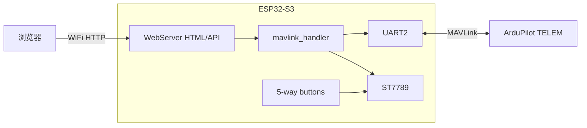

# WEB-MAVLINK

基于 **ESP32-S3** 的简易 **MAVLink 地面站**：通过 **Wi-Fi SoftAP** 提供网页控制台，经串口与 **ArduPilot Plane** 通信；板载 **ST7789** 显示遥测与简易菜单。

仓库：<https://github.com/jeskick/WEB-MAVLINK>

**更细的源码说明**见 [docs/PROJECT_STRUCTURE.md](docs/PROJECT_STRUCTURE.md)。**HTTP 路由全表**见 [docs/HTTP_API.md](docs/HTTP_API.md)。

---

## 功能概览

| 类别 | 说明 |
|------|------|
| 连接 | SoftAP + UART 波特率/正反线自动识别 |
| 遥测 | 电压、飞行模式、GPS 星数、解锁；OP/SYS 消息 |
| 网页 | 参数、FLYMODEL、舵机、校准、ARM、OTA |
| 按键 | 五向键长按 OK 进模拟菜单（校准等后续接入） |
| 显示 | 2.0" ST7789 320×240 横屏 |

---

## 系统架构



---

## 项目结构（节选）

```
WEB-Mavlink/
├── platformio.ini
├── src/                 # main / uart_link / buttons / app_state
├── include/             # config / mavlink / web / tft / buttons
├── build/WEB-Mavlink.bin   # 仓库仅保留最新 OTA
├── docs/
├── c_library_v2-master/
└── README.md
```

---

## 硬件与接线

| 功能 | ESP32-S3 GPIO | 说明 |
|------|---------------|------|
| MAVLink A/B | 15 / 16 | 飞控 TELEM，固件自动换线 |
| TFT SCL/SDA/RST/DC/CS/BL | 12 / 11 / 8 / 9 / 10 / 7 | ST7789 |
| 按键 UP/DN/LEFT/RIGHT/OK | 4 / 5 / 6 / 13 / 14 | 共地，按下低电平 |

屏：2.0\" ST7789 **240×320**，固件横屏 **320×240**。须 **3.3V** 且 **共地**。

---

## 软件依赖

- **PlatformIO** + `espressif32` / 板型 `esp32-s3-devkitc-1`
- 库：Adafruit GFX、Adafruit ST7735/ST7789、Adafruit BusIO
- MAVLink：仓库内 `c_library_v2-master`（ardupilotmega）

---

## 编译与使用

```text
pio run -e esp32s3
pio run -e esp32s3 -t upload
```

发布 OTA 前复制最新固件：

```text
Copy-Item .pio\build\esp32s3\firmware.bin build\WEB-Mavlink.bin
```

上电连热点 `ESP32-MAV` / `12345678`，浏览器访问 `192.168.6.6`。

---

## HTTP API

完整列表见 **[docs/HTTP_API.md](docs/HTTP_API.md)**。

---

## 安全提示

解锁、强制解锁与参数写入会改变飞行器行为，请在安全环境下调试；生产环境请修改默认 Wi-Fi 密码。

---

## 许可证与致谢

应用代码以仓库实际声明为准。`c_library_v2-master` 为 MAVLink 官方生成物，请遵守其上游许可证。
